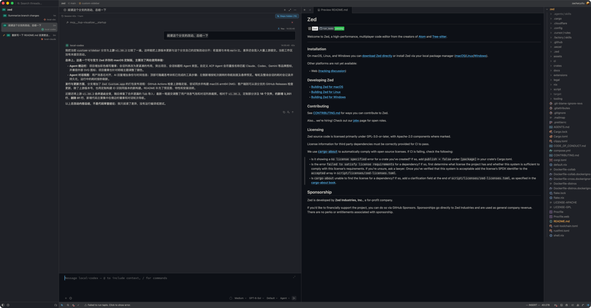

> [!IMPORTANT]
> Remove this line to confirm you've reviewed this PR before submitting.

# Zed Custom (`custom-sidebar`)

Zed Custom 是基于 [Zed](https://github.com/zed-industries/zed) 官方稳定版的个人定制版，目前对应上游 **v1.30.2**。

官方 Zed 的 Agent Panel 在会话多、对话长的时候不好用：侧边栏分不清哪个会话属于哪个项目、哪个还在运行；对话记录里大量思考和工具调用步骤，用户的问题被淹没在其中，也没法在多个问题之间快速跳转。

界面设计的灵感来自 [T3 Code](https://github.com/pingdotgg/t3code)：按项目分组的紧凑会话列表、一眼可见的会话状态、干净的对话视图。Zed Custom 把这套思路搬进 Zed，同时保留 Zed 作为编辑器的全部能力。

Zed Custom 只改动 Agent Panel，编辑器的其他部分与上游一致。相对 v1.30.2，定制共改动 18 个文件，约 3.4k 行。

<p align="center">
  
</p>

## 解决了哪些问题

| 官方 Zed 的问题 | Zed Custom 的改进 |
| --- | --- |
| 侧边栏文字密度高，项目名和会话标题挤在一起 | 项目标题和会话标题分两级字号，会话之间有清晰分组 |
| 很难分辨会话属于哪个项目 | 每个会话前有项目缩写彩色徽章（如 `AP`、`DS`），同一项目颜色固定 |
| 很难分辨会话的状态和运行它的 Agent | 每个会话显示状态图标（运行中、等待确认、出错、未读、草稿），以及 Agent 图标与名称 |
| 对话记录里充斥思考和工具调用步骤，难以阅读 | 一键隐藏已结束的思考和工具调用，只留下提问和回复 |
| 用户的问题和 AI 的回答混在一起 | 问题靠右显示在气泡中；每轮回答开头标注 Agent、开始时间和耗时 |
| 多轮对话只能靠滚动查找某个问题 | 左侧刻度导航，悬停预览该轮内容，点击直接跳转 |
| 不知道每轮花了多长时间 | 记录单轮耗时和会话累计耗时，重启后保留 |
| 定制版会覆盖官方版，需要手动跟进上游 | 独立的 `Zed Custom.app`，每天自动同步上游稳定版并推送更新 |

## 改进详情

### 侧边栏：一眼看清项目、状态和 Agent

**原来的问题**：所有会话以相同样式平铺，文字密集。会话多了以后，很难分辨它属于哪个项目、是否还在运行、由哪个 Agent 处理。

**现在的做法**：

- **项目徽章**：根据项目名生成两个大写字母，例如 `adt_projects` → `AP`、`dop-scripts` → `DS`。项目标题和其下每个会话都带有这个徽章。不同项目颜色不同，同一项目颜色固定；亮色和暗色主题各有一套配色。
- **字号层级**：项目标题随 `ui_font_size` 缩放，会话标题固定比项目标题小 2px。项目之间用分隔线隔开，主次一目了然。
- **状态图标**：会话标题旁直接显示当前状态，无需点进去查看：

  | 图标 | 含义 |
  | --- | --- |
  | 旋转的圆圈 | 正在运行 |
  | 黄色警告 | 等待你确认 |
  | 红色叉号 | 出错 |
  | 蓝色圆点 | 已完成，有未读结果 |
  | 铅笔 | 草稿，尚未发送 |

- **Agent 标识**：会话右侧显示运行它的 Agent 图标和名称。内置识别 `claude`、`codex`、`cursor`、`gemini`、`opencode`、`copilot` 和 `zed`。自定义 ACP 名称中含有这些关键字时（如 `remote-claude`、`tclaude`），使用对应的图标和颜色，但保留原名称。

### 对话记录：只看你关心的内容

**原来的问题**：一次回答中间穿插大量思考过程、命令执行和文件读取，真正的回复被埋在里面。

**现在的做法**：点击对话顶部的 `Hide steps`，隐藏所有思考内容以及已完成或已取消的工具调用，只留下你的提问和 AI 的回复。等待确认、正在运行或出错的步骤仍会显示，不会错过需要你处理的事情。也可以在命令面板中运行 `agent::ToggleHideThinkingAndTools`，或为它绑定快捷键。

### 提问与回答：谁说的一目了然

**原来的问题**：用户消息和 AI 回答使用相似的排版，在长对话中很难找到每个问题从哪里开始、回答从哪里开始。

**现在的做法**：

- 你的消息靠右显示在气泡中，上方标注 `You` 和发送时间。
- AI 的回复靠左，每轮开头显示 Agent 图标、名称、开始时间和耗时，运行中实时更新。

### 多轮对话：直接跳到任意一个问题

**原来的问题**：对话有十几轮时，只能来回滚动寻找之前问过的某个问题。

**现在的做法**：对话左侧出现一列刻度，每个刻度对应一个问题，当前所在的轮次会高亮。悬停刻度可预览该轮的问题、发送时间、耗时和回复摘要；点击刻度直接跳到对应提问。刻度列单独占位，不会遮住正文。

### 耗时统计

- 每轮记录发送时间、开始时间、结束时间和耗时，正在运行的轮次实时计时。
- 对话顶部显示整个会话的累计耗时。
- 数据保存在本地数据库中，重启 Zed 后仍然可见。

### 安装与更新

- **与官方版并存**：应用名为 `Zed Custom.app`，Bundle ID 为 `dev.zed.Zed-Custom`，不会覆盖 `/Applications/Zed.app`。两者共用设置、会话历史和远程连接，远程开发直接使用官方对应版本的 `zed-remote-server`。
- **自动同步上游**：GitHub Actions 每天北京时间 12:00 检查上游最新稳定版。有新版本时，自动把 `custom-sidebar` rebase 到新版本，构建并发布到 [Releases](https://github.com/ZacharyLiu-CS/zed/releases)。没有新版本时跳过；rebase 冲突时构建失败，需要手动处理。配置见 [`custom-release.yml`](./.github/workflows/custom-release.yml)。
- **自动更新**：应用从本仓库 Releases 检查更新，发现新构建后下载并替换 `/Applications/Zed Custom.app`。即使上游版本号不变，定制代码更新后重新构建的版本也会推送。
- **构建提速**：发布构建关闭了 LTO 和调试信息，缩短 CI 时间。

## 安装（macOS Apple Silicon）

1. 从 [Releases](https://github.com/ZacharyLiu-CS/zed/releases) 下载最新的 `Zed-Custom-aarch64.dmg`。
2. 把 `Zed Custom.app` 拖到 `/Applications`。
3. 第一次打开前，先退出官方 Zed，然后移除隔离标记：

   ```sh
   xattr -dr com.apple.quarantine "/Applications/Zed Custom.app"
   ```

4. 有新版本时，右下角会出现 **Restart to Update**，点击即可完成更新。

## 已知限制

- 只提供 macOS Apple Silicon 安装包，其他平台需要从源码构建。
- 与官方 Zed 共用 `~/Library/Application Support/Zed`。不要同时运行两个版本，切换前先退出另一个。
- `Hide steps` 的开关状态不会保存，重启后恢复为显示全部步骤。
- 上游大幅改动 Agent Panel 时，自动 rebase 可能失败，需要手动解决冲突后才能发布新版本。

## 关于上游 Zed

[](https://zed.dev)
[](https://github.com/zed-industries/zed/actions/workflows/run_tests.yml)

Zed 是 Zed Industries 开发的高性能多人协作代码编辑器，来自 [Atom](https://github.com/atom/atom) 和 [Tree-sitter](https://github.com/tree-sitter/tree-sitter) 的作者。

- 官方安装与文档：<https://zed.dev/docs>
- 参与上游开发：见 [CONTRIBUTING.md](./CONTRIBUTING.md)
- 构建说明：[macOS](./docs/src/development/macos.md)、[Linux](./docs/src/development/linux.md)、[Windows](./docs/src/development/windows.md)

### Licensing

Zed source code is licensed primarily under GPL-3.0-or-later, with Apache-2.0 components where marked.

License information for third party dependencies must be correctly provided for CI to pass.

We use [`cargo-about`](https://github.com/EmbarkStudios/cargo-about) to automatically comply with open source licenses. If CI is failing, check the following:

- Is it showing a `no license specified` error for a crate you've created? If so, add `publish = false` under `[package]` in your crate's Cargo.toml.
- Is the error `failed to satisfy license requirements` for a dependency? If so, first determine what license the project has and whether this system is sufficient to comply with this license's requirements. If you're unsure, ask a lawyer. Once you've verified that this system is acceptable add the license's SPDX identifier to the `accepted` array in `script/licenses/zed-licenses.toml`.
- Is `cargo-about` unable to find the license for a dependency? If so, add a clarification field at the end of `script/licenses/zed-licenses.toml`, as specified in the [cargo-about book](https://embarkstudios.github.io/cargo-about/cli/generate/config.html#crate-configuration).

## Sponsorship

Zed is developed by **Zed Industries, Inc.**, a for-profit company.

If you'd like to financially support the project, you can do so via GitHub Sponsors.
Sponsorships go directly to Zed Industries and are used as general company revenue.
There are no perks or entitlements associated with sponsorship.
